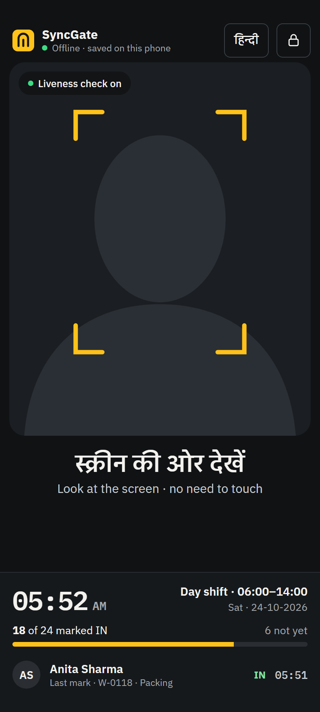
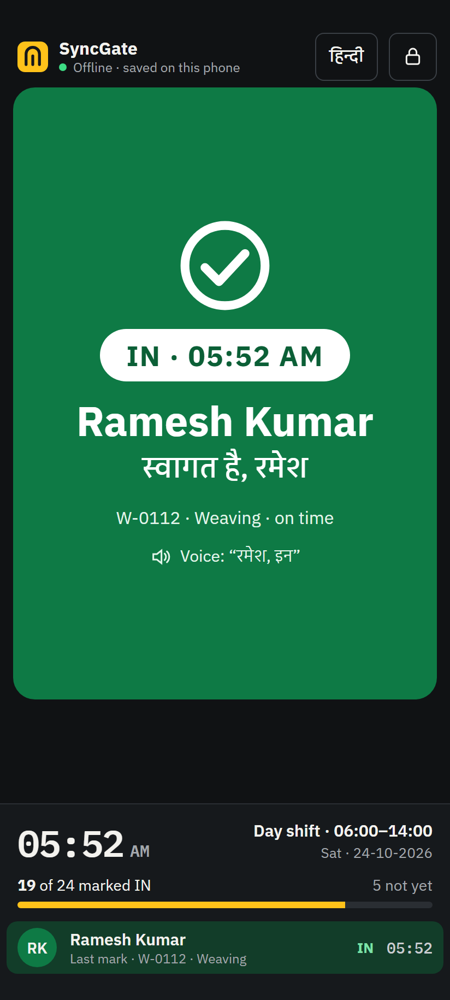
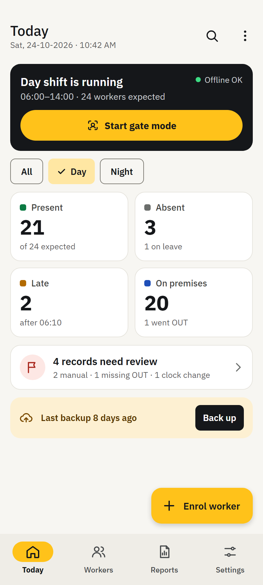
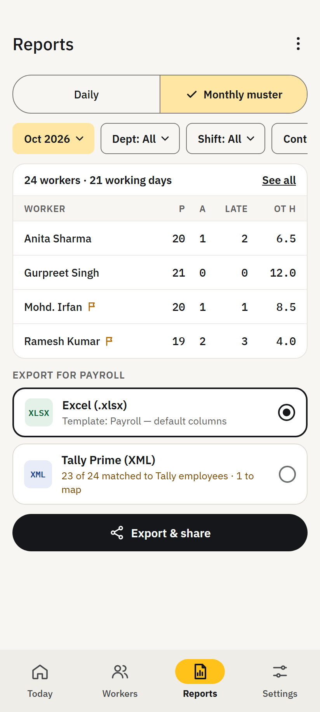
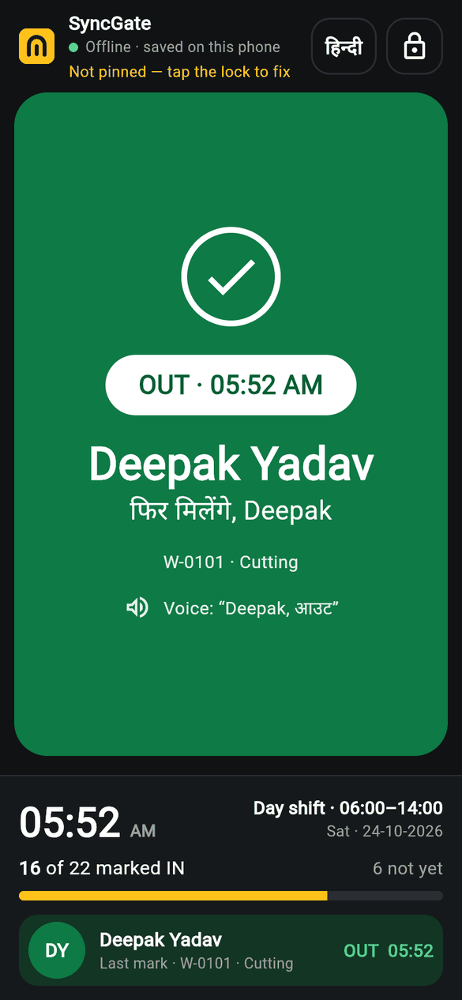
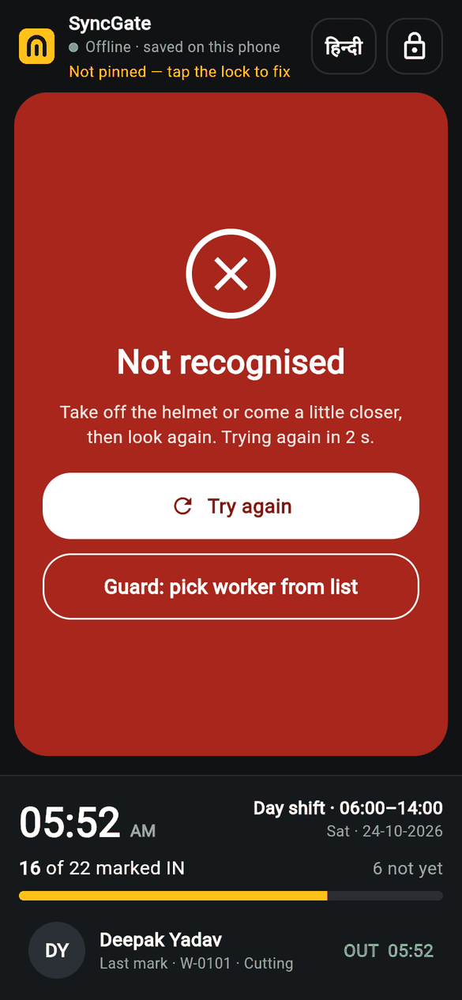
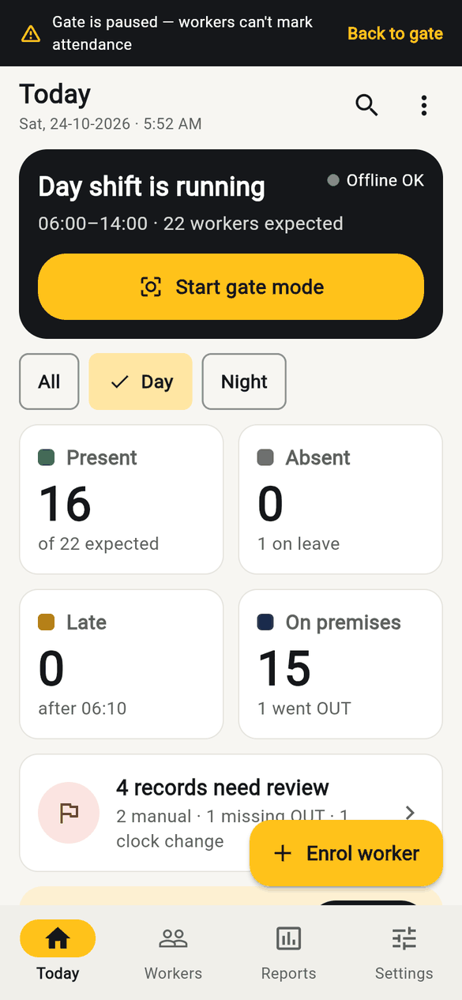
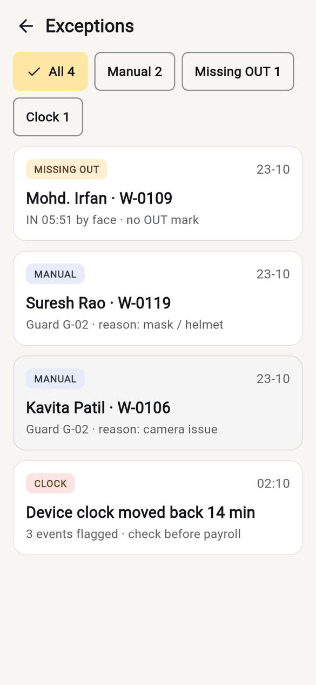
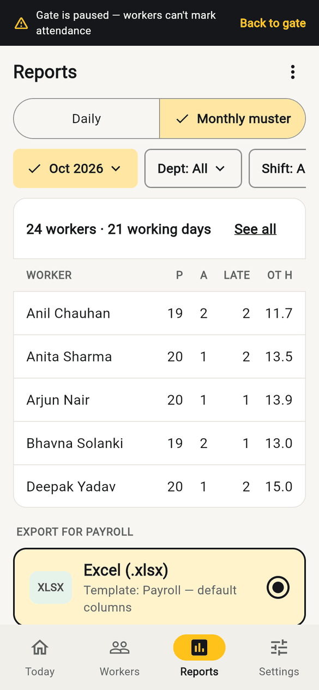
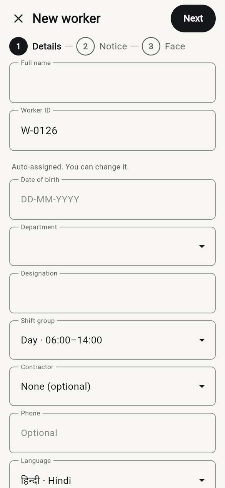

<div align="center">

# SyncGate

**Offline face-recognition attendance for factory gates, on one budget Android phone.**

Privacy-first · DPDP-ready · Works with no internet · Android and iOS from one Flutter codebase

[](https://github.com/Luffy610/SyncGate/actions/workflows/pr.yml)


-orange)

</div>

---

## Contents

- [What is SyncGate?](#what-is-syncgate)
- [Features](#features)
- [Project status](#project-status)
- [Screens](#screens)
- [Quick start](#quick-start)
- [Step-by-step setup](#step-by-step-setup)
  - [Windows](#windows)
  - [macOS](#macos)
  - [Linux](#linux)
- [Get the code and run it](#get-the-code-and-run-it)
- [Try the demo](#try-the-demo)
- [Run the tests](#run-the-tests)
- [Troubleshooting](#troubleshooting)
- [Repository layout](#repository-layout)
- [Architecture in brief](#architecture-in-brief)
- [Documentation](#documentation)
- [Contributing](#contributing)
- [Security and privacy](#security-and-privacy)
- [Licence](#licence)

---

## What is SyncGate?

Small factories that employ contract and daily-wage workers still mark attendance on paper or with shared fingerprint machines. Both are slow, easy to cheat and hard to audit.

SyncGate turns **one phone at the factory gate** into an attendance terminal. A worker looks at the phone, the app recognises the face in under a second and says their name aloud in their own language. The same phone doubles as the owner's **admin console**: enrol workers, fix mistakes, and export a muster roll for payroll (Excel or Tally).

- **Offline by design.** No internet is needed to mark attendance.
- **Face templates never leave the phone.** They are stored encrypted on the device.
- **Built for budget phones** and for people who may not read well: big targets, voice prompts, Hindi and English today, more Indian languages planned.
- **Built for India's DPDP Act**: explicit worker consent, a notice in the worker's language, an audit trail, and deletion on request.

Phase 1 covers **one device and up to 25 workers per factory**. Multi-gate sync and contractor channels are out of scope for now (see [the PRD](docs/PRD.md)).

## Features

| Area | What it does |
|---|---|
| **Gate mode** | Full-screen face scan, IN/OUT marking, spoken confirmation, "not recognised" handling and a manual-entry fallback for the supervisor. |
| **Setup wizard** | Language, licence activation (QR or key), first shift, camera/lighting check, kiosk lock, owner PIN and recovery code, first worker. |
| **Admin unlock** | Role-based PINs (owner, admin, gate operator) with lock-out after repeated mistakes; the app returns to the gate after idle time. |
| **Today** | Who is in, out, late or absent, live at the gate's pace, plus a count of records that need review. |
| **Workers and enrolment** | Add workers, record consent, guided face capture, duplicate-face detection, deactivate or re-enrol. |
| **Exceptions** | Review missing OUT marks and odd records; correct them with a reason, all of it audited. |
| **Reports** | Monthly muster grid, Excel export for payroll, Tally mapping. |
| **Settings** | Shifts, users, backup (with passphrase), language, gate behaviour, privacy, licence and about. |
| **Look and feel** | Native-feeling **iOS** and **Android** versions of every screen, from one set of components. |

## Project status

> **Pre-alpha. The whole app runs on demo data.**

The Flutter front end for every Phase 1 screen is built and tested (steps F0–F5 of the [frontend plan](docs/delivery/frontend-implementation-plan.md)). It runs against in-memory fakes and a scripted camera, so you can try the full flow today without a face, a licence server or a database.

| Stage | State |
|---|---|
| F0–F5: monorepo, design system, gate, setup, admin screens, reports, settings | ✅ Done, on demo data |
| F6: real database (SQLCipher), native camera and face model, licence server, share/audio plugins | ⏳ Next |
| F7: restore, Drive backup, more languages, store release | ⏳ Planned |
| Golden (screenshot) tests, bundled fonts, iOS flavour schemes | ⏳ Need font files and a Mac |

The **staging** and **prod** flavours deliberately show a "not connected to its back end yet" screen until F6 lands. Use **dev**.

## Screens

Every screen is designed twice, once for Android and once for iOS. All 34 images are in [`docs/designs/`](docs/designs).

| Gate | Matched | Today | Reports |
|---|---|---|---|
|  |  |  |  |

The running app on demo data (Android look; the iOS look is in [`docs/screenshots/ios`](docs/screenshots/ios)):

| Matched at the gate | Not recognised | Today | Exceptions | Reports | Enrol worker |
|---|---|---|---|---|---|
|  |  |  |  |  |  |

---

## Quick start

For people who already have Flutter. Everything else is below.

```bash
git clone https://github.com/Luffy610/SyncGate.git
cd SyncGate
dart pub global activate melos
melos bootstrap
melos run gen

cd apps/mobile
flutter run --flavor dev -t lib/main_dev.dart --dart-define-from-file=env/dev.json --dart-define=DEV_START=gate
```

You need Flutter **3.47.8** (pinned in [`.fvmrc`](.fvmrc)) and either an Android emulator/phone, or the [browser preview](#option-c--in-a-browser-no-emulator-needed).

---

## Step-by-step setup

Pick your operating system. Each section takes a clean machine to a working Flutter toolchain.

### What you can build where

| Your machine | Run on Android | Run on iOS | Browser preview | Run all tests |
|---|:---:|:---:|:---:|:---:|
| **Windows 10/11** | ✅ | ❌ (Xcode needs macOS) | ✅ | ✅ |
| **macOS** | ✅ | ✅ | ✅ | ✅ |
| **Linux** | ✅ | ❌ | ✅ | ✅ |

### What you will install

| Tool | Version | Why |
|---|---|---|
| Git | 2.40+ | Clone the repo |
| Flutter SDK (includes Dart) | **3.47.8** (stable) | The framework. The repo pins this version in `.fvmrc`. |
| Melos | 8.x | Runs commands across all packages in the monorepo |
| Android Studio | latest | Android SDK, emulator, and the JDK Flutter uses |
| Android SDK | Platform **36** and **35**, Build-Tools **36**, NDK **28.2.13676358**, Platform-Tools, Emulator | Android builds |
| Xcode and CocoaPods | Xcode 16+, CocoaPods 1.15+ | iOS builds (macOS only) |
| VS Code or Android Studio | latest, with the Flutter and Dart plugins | Editing and debugging |

Budget **about 15 GB** of disk: Flutter is ~3 GB, the Android SDK and one emulator image ~10 GB.

> **Do I need FVM?** No. FVM (Flutter Version Management) is optional. It makes sure you use exactly the Flutter version the repo pins. If you install Flutter by hand, install version **3.47.8** (see [Install a specific version](#install-a-specific-flutter-version)).

---

### Windows

Tested on Windows 10 and 11. Use **PowerShell** (not `cmd`).

**1. Install Git**

```powershell
winget install --id Git.Git -e
```

Close and reopen PowerShell so `git` is on your PATH.

**2. Turn on Developer Mode.** Flutter plugins need symlink support.

```powershell
start ms-settings:developers
```

Switch **Developer Mode** on.

**3. Install Flutter**

```powershell
git clone https://github.com/flutter/flutter.git -b stable C:\src\flutter
cd C:\src\flutter
git checkout 3.47.8
[Environment]::SetEnvironmentVariable("Path", [Environment]::GetEnvironmentVariable("Path", "User") + ";C:\src\flutter\bin", "User")
```

Open a **new** PowerShell window, then:

```powershell
flutter --version
```

The first run downloads the Dart SDK and takes a few minutes. It should print `Flutter 3.47.8`.

> Don't install Flutter under `C:\Program Files` or any path with spaces; it needs a folder you can write to.

**4. Install Android Studio**

```powershell
winget install --id Google.AndroidStudio -e
```

Start it once and let the setup wizard finish (it downloads the first SDK). Then open **More Actions → SDK Manager**:

- *SDK Platforms:* tick **Android 16 (API 36)** and **Android 15 (API 35)**.
- *SDK Tools* (tick **Show Package Details**): **Android SDK Build-Tools 36**, **NDK (Side by side) 28.2.13676358**, **Android SDK Command-line Tools (latest)**, **Android SDK Platform-Tools**, **Android Emulator**.

Click **Apply**.

**5. Accept the Android licences**

```powershell
flutter doctor --android-licenses
```

Press `y` at each prompt.

**6. Create an emulator** (skip if you will use a real phone)

Android Studio → **More Actions → Virtual Device Manager → Create device** → *Pixel 7* → system image **API 35** → Finish. Under *Advanced settings* set **Front camera** to `Webcam0` to use your laptop webcam.

The emulator needs hardware acceleration: turn on **Windows Hypervisor Platform** (Windows Features) and virtualisation in the BIOS if `emulator -accel-check` complains.

**7. Or use a real Android phone**

On the phone: *Settings → About phone → tap Build number 7 times*, then *Developer options → USB debugging* on. Plug it in and accept the prompt.

**8. Install Melos and add the pub cache to PATH**

```powershell
dart pub global activate melos
[Environment]::SetEnvironmentVariable("Path", [Environment]::GetEnvironmentVariable("Path", "User") + ";$env:LOCALAPPDATA\Pub\Cache\bin", "User")
```

Open a new PowerShell window, then check everything:

```powershell
flutter doctor -v
melos --version
```

You need green ticks for **Flutter** and **Android toolchain**. Warnings about *Chrome*, *Visual Studio* and *Linux* are fine (SyncGate does not target desktop).

Next: [Get the code and run it](#get-the-code-and-run-it).

---

### macOS

Works on Apple Silicon and Intel. Use **Terminal** (zsh).

**1. Install Homebrew, Git and Flutter**

```bash
/bin/bash -c "$(curl -fsSL https://raw.githubusercontent.com/Homebrew/install/HEAD/install.sh)"
brew install git
git clone https://github.com/flutter/flutter.git -b stable ~/development/flutter
cd ~/development/flutter && git checkout 3.47.8
echo 'export PATH="$HOME/development/flutter/bin:$HOME/.pub-cache/bin:$PATH"' >> ~/.zshrc
source ~/.zshrc
flutter --version
```

It should print `Flutter 3.47.8`.

**2. Install Android Studio and the Android SDK**

```bash
brew install --cask android-studio
```

Open it once and finish the setup wizard. Then **More Actions → SDK Manager** and tick:

- *SDK Platforms:* **Android 16 (API 36)** and **Android 15 (API 35)**.
- *SDK Tools* (tick **Show Package Details**): **Build-Tools 36**, **NDK (Side by side) 28.2.13676358**, **Command-line Tools (latest)**, **Platform-Tools**, **Android Emulator**.

Accept the licences:

```bash
flutter doctor --android-licenses
```

Create an emulator in **Virtual Device Manager** (Pixel 7, API 35), or plug in a phone with USB debugging on.

**3. Set up iOS** (Mac only)

Install **Xcode 16 or newer** from the App Store, then:

```bash
sudo xcode-select --switch /Applications/Xcode.app/Contents/Developer
sudo xcodebuild -runFirstLaunch
xcodebuild -downloadPlatform iOS
brew install cocoapods
open -a Simulator
```

To run on a **physical iPhone**: open `apps/mobile/ios/Runner.xcworkspace` in Xcode once, pick your Apple ID team under **Signing & Capabilities**, then trust the developer certificate on the phone (*Settings → General → VPN & Device Management*).

**4. Install Melos**

```bash
dart pub global activate melos
```

**5. Check everything**

```bash
flutter doctor -v
melos --version
```

You need green ticks for **Flutter**, **Android toolchain** and **Xcode**. Ignore *Chrome* and *Linux* warnings.

Next: [Get the code and run it](#get-the-code-and-run-it).

---

### Linux

Commands are for Debian/Ubuntu. On Fedora use `dnf`, on Arch use `pacman` for the equivalent packages.

**1. Install the basics**

```bash
sudo apt update
sudo apt install -y curl git unzip xz-utils zip libglu1-mesa
```

**2. Install Flutter**

```bash
git clone https://github.com/flutter/flutter.git -b stable ~/development/flutter
cd ~/development/flutter && git checkout 3.47.8
echo 'export PATH="$HOME/development/flutter/bin:$HOME/.pub-cache/bin:$PATH"' >> ~/.bashrc
source ~/.bashrc
flutter --version
```

It should print `Flutter 3.47.8`. (Using zsh? Put the `export` line in `~/.zshrc` instead.)

**3. Install Android Studio**

Download it from <https://developer.android.com/studio>, then:

```bash
sudo tar -xzf ~/Downloads/android-studio-*-linux.tar.gz -C /opt
/opt/android-studio/bin/studio.sh
```

(Snap works too: `sudo snap install android-studio --classic`.) Let the setup wizard finish, then **More Actions → SDK Manager** and tick:

- *SDK Platforms:* **Android 16 (API 36)** and **Android 15 (API 35)**.
- *SDK Tools* (tick **Show Package Details**): **Build-Tools 36**, **NDK (Side by side) 28.2.13676358**, **Command-line Tools (latest)**, **Platform-Tools**, **Android Emulator**.

If Flutter can't find the SDK or JDK:

```bash
flutter config --android-sdk "$HOME/Android/Sdk"
flutter config --jdk-dir /opt/android-studio/jbr
```

Accept the licences:

```bash
flutter doctor --android-licenses
```

**4. Emulator acceleration (KVM)**

The Android emulator needs KVM.

```bash
sudo apt install -y qemu-kvm
sudo adduser "$USER" kvm
```

Log out and back in. Check with `ls -l /dev/kvm`. Then create a Pixel 7 / API 35 emulator in **Virtual Device Manager**.

**5. Or use a real phone**

Enable *Developer options → USB debugging*, plug in, accept the prompt. If `flutter devices` doesn't list it, install udev rules: `sudo apt install -y android-sdk-platform-tools-common`.

**6. Install Melos**

```bash
dart pub global activate melos
```

**7. Check everything**

```bash
flutter doctor -v
melos --version
```

You need green ticks for **Flutter** and **Android toolchain**. Ignore *Chrome*, *Linux toolchain* and *Android Studio not found* warnings if you use the command-line tools.

Next: [Get the code and run it](#get-the-code-and-run-it).

---

### Install a specific Flutter version

If you already have Flutter, move it to the pinned version:

```bash
cd <your flutter folder>      # e.g. ~/development/flutter or C:\src\flutter
git fetch --tags
git checkout 3.47.8
flutter --version
```

**Prefer FVM?** It handles this for you and keeps several Flutter versions side by side.

```bash
dart pub global activate fvm   # or: brew install fvm
cd SyncGate
fvm install                    # reads .fvmrc
fvm flutter --version          # use "fvm flutter ..." instead of "flutter ..." from here on
```

---

## Get the code and run it

These steps are the same on every OS.

### 1. Clone and install dependencies

```bash
git clone https://github.com/Luffy610/SyncGate.git
cd SyncGate
melos bootstrap       # installs dependencies for every package and the app
melos run gen         # generates the translation classes (needed once, and after editing .arb files)
```

> If `melos` isn't found, the pub cache isn't on your PATH: add `%LOCALAPPDATA%\Pub\Cache\bin` (Windows) or `$HOME/.pub-cache/bin` (macOS/Linux) and open a new terminal.

### 2. Pick a device

```bash
cd apps/mobile
flutter devices
```

You should see your emulator, phone, or (on a Mac) the iOS simulator. No device yet? Start an emulator:

```bash
flutter emulators                       # list them
flutter emulators --launch <emulator id>
```

### 3. Run the app

#### Option A — Android emulator or phone (recommended)

```bash
cd apps/mobile
flutter run --flavor dev -t lib/main_dev.dart --dart-define-from-file=env/dev.json
```

Add `--dart-define=DEV_START=gate` to skip the setup wizard and land on the gate with demo data. With more than one device connected, add `-d <device id>`.

The first build takes several minutes (Gradle downloads dependencies). Later builds take seconds, and while the app runs you can press **`r`** for hot reload and **`R`** for hot restart.

#### Option B — iPhone simulator or device (macOS only)

The Xcode schemes for flavours are not set up yet, so run **without** `--flavor`:

```bash
cd apps/mobile
open -a Simulator
flutter run -t lib/main_dev.dart --dart-define-from-file=env/dev.json
```

The first time, if CocoaPods complains: `cd ios && pod install --repo-update && cd ..`.

#### Option C — In a browser (no emulator needed)

This is the quickest way to look around, on any OS. It runs the same dev build with the fake camera. It is a **preview only**: it is not a supported target and some phone features (kiosk lock, native camera) are simulated.

The web platform files are not kept in the repo, so create them once (they are git-ignored):

```bash
cd apps/mobile
flutter create --platforms=web --project-name syncgate .
```

> This also writes a few stray files (`README.md`, `analysis_options.yaml`, `syncgate.iml`, `test/widget_test.dart`). Delete them afterwards; only the `web/` folder is needed.

Then run:

```bash
flutter run -d web-server --web-port 8080 -t lib/main_dev.dart --dart-define=BUILD_FLAVOUR=dev --dart-define=DEV_START=gate
```

Open <http://localhost:8080> and make the window phone-sized (about 390 × 800). In Chrome press **F12**, then **Ctrl/Cmd + Shift + M** for device mode. The first compile takes a couple of minutes.

#### All flavours

| Flavour | Command (from `apps/mobile`) | Use |
|---|---|---|
| **dev** | `flutter run --flavor dev -t lib/main_dev.dart --dart-define-from-file=env/dev.json` | Day-to-day work. Fake camera, demo data, debug panel. |
| staging | `flutter run --flavor staging -t lib/main_staging.dart --dart-define-from-file=env/staging.json` | QA and beta builds. Needs the real back end (F6). |
| prod | `flutter run --release --flavor prod -t lib/main_prod.dart --dart-define-from-file=env/prod.json` | Customer build; no debug features. Needs the real back end (F6). |

Until F6 lands, staging and prod show a "not connected to its back end yet" screen. That is expected.

### 4. Build an installable APK (optional)

```bash
cd apps/mobile
flutter build apk --debug --flavor dev -t lib/main_dev.dart --dart-define-from-file=env/dev.json
```

The file is at `build/app/outputs/flutter-apk/app-dev-debug.apk`. Install it with `adb install <path>` or copy it to a phone.

---

## Try the demo

The dev flavour is a complete working app on fake data. Nothing you do leaves your machine.

**Suggested tour (about 5 minutes)**

1. **Setup wizard** (fresh install): choose a language → tap **Scan QR on invoice** (fills a demo licence) → **Activate** → shift → camera check → kiosk → choose an owner PIN → write down the recovery code → **Enrol first worker**.
   *Skip all this with `--dart-define=DEV_START=gate`.*
2. **Enrol** a worker: details → consent notice → watch the scripted face capture finish.
3. **Gate**: long-press the **SyncGate logo** to open the **debug panel**, pick a worker to "walk up". The app marks IN and shows the name (the voice is simulated in the demo).
4. **Unlock**: tap the admin icon, enter a PIN. You land on **Today**.
5. **Exceptions**: open "records need review", fix a missing OUT with a reason.
6. **Reports**: open the month, tap **Export & share**.
7. Back in the debug panel try **Component catalogue**, the language switch, and the iOS/Android look toggle.

**Demo credentials (dev only)**

| What | Value |
|---|---|
| Owner PIN | `123456` |
| Admin PIN | `234567` |
| Gate operator PIN | `345678` |
| Licence key | tap *Scan QR on invoice* → `SGT-4F7K-2Q9M-A1B2` |
| Simulate "no internet" at activation | any key containing `NONET`, e.g. `SGT-NONE-T123-4567` |

A PIN you create in the wizard replaces the owner PIN.

**Demo clock.** The app pretends it is **Saturday 24-10-2026, 05:52** (the time in the designs) and then runs in real time. The debug panel moves it forward +10 min, +1 h or +8 h so you can see late, absent and end-of-shift behaviour.

**Debug panel (long-press the logo at the gate).** It can fire scripted camera events (a worker walking up, not recognised, each lighting/quality hint, an unknown face), start a demo loop, move the clock, flip "pinned" / "not pinned", switch the iOS/Android look, make the next enrolment find a duplicate face, open the component catalogue, and reset to a fresh install.

---

## Run the tests

From the repo root:

```bash
melos run analyze        # import-boundary check + dart analyze (warnings fail the run)
melos run test           # unit and widget tests in every package
melos run format:check   # fails if any Dart file needs formatting
```

To fix formatting: `dart format .`

Run one package or one file:

```bash
cd packages/sg_domain && dart test
cd packages/sg_ui && flutter test
cd apps/mobile && flutter test test/e2e_test.dart
```

What is covered:

| Package | Tests |
|---|---|
| `sg_domain` | Attendance rules, shift windows, "today" calculations (pure Dart) |
| `sg_ui` | Every shared component, in both iOS and Android looks, at 1.3× text size |
| `sg_l10n` | Date/time formats and English-Hindi key parity |
| `apps/mobile` | Each screen group, plus an end-to-end test: fresh install → setup → enrol → mark at gate → correct a record → export, on both platforms |

CI (`.github/workflows/pr.yml`) runs format, analyze and test on every pull request. Run the same three commands before you push.

> **Golden (screenshot) tests** are planned but not added yet. They need the bundled fonts and a Linux runner so results are identical everywhere. `melos run test:golden` will report "No package found" until then.

---

## Troubleshooting

| Symptom | Fix |
|---|---|
| `flutter: command not found` | Open a **new** terminal after editing PATH, or use `fvm flutter`. |
| Flutter version is not 3.47.8 | See [Install a specific version](#install-a-specific-flutter-version). |
| `melos: command not found` | Add the pub cache `bin` folder to PATH (see step 1 above). |
| `Building with plugins requires symlink support` (Windows) | Turn on Developer Mode: `start ms-settings:developers`. |
| `Android license status unknown` | `flutter doctor --android-licenses` |
| `Unable to locate Android SDK` | `flutter config --android-sdk <path>` (Windows default `%LOCALAPPDATA%\Android\Sdk`, macOS `~/Library/Android/sdk`, Linux `~/Android/Sdk`). |
| `JAVA_HOME is not set` during a Gradle build | `flutter config --jdk-dir "<Android Studio>/jbr"` (Windows: `C:\Program Files\Android\Android Studio\jbr`; macOS: `/Applications/Android Studio.app/Contents/jbr/Contents/Home`). |
| `Flutter requires Android SDK 36` or NDK not found | Install Platform 36, Build-Tools 36 and NDK 28.2.13676358 from SDK Manager. |
| Emulator won't start / very slow | Windows: enable Windows Hypervisor Platform. Linux: install KVM and join the `kvm` group. macOS: use an arm64 image on Apple Silicon. |
| Emulator camera is black | AVD settings → Advanced → Front camera → `Webcam0`. The dev flavour doesn't need a camera. |
| Missing `AppLocalizations` / `app_localizations.dart` errors | Run `melos run gen`. Generated translation files are git-ignored. |
| `CocoaPods not installed` or pod errors (macOS) | `brew install cocoapods`, then `cd apps/mobile/ios && pod install --repo-update`. |
| `flutter run` says "no devices" | Start an emulator, plug in a phone, or use [the browser preview](#option-c--in-a-browser-no-emulator-needed). |
| `No web server device` / "This application is not configured to build on the web" | Run the `flutter create --platforms=web` step in Option C. |
| Gradle download fails behind a proxy or is very slow | Retry; or set the proxy in `~/.gradle/gradle.properties`. |
| Hindi text shows boxes | Fonts are not bundled yet (planned). On a real device the system Devanagari font is used; in tests Roboto is loaded. |
| Stale build problems | `cd apps/mobile && flutter clean && cd ../.. && melos bootstrap && melos run gen` |

Still stuck? Run `flutter doctor -v` and open an issue with its output.

---

## Repository layout

```
apps/mobile/          The Flutter app (flavours dev | staging | prod)
  lib/src/app/          App shell, routing, app modes, idle timer
  lib/src/features/     One folder per screen group (gate, setup, today, workers, ...)
  lib/src/application/  Use cases (mark attendance, correct a record, ...)
  lib/src/dev/          Demo data, fakes and debug tools (dev flavour only)
packages/sg_domain/   Pure Dart: entities, attendance rules, shift engine, repository interfaces
packages/sg_ui/       Design tokens and adaptive iOS/Android components
packages/sg_l10n/     Translations (ARB: English, Hindi) and Indian date/time formats
packages/sg_platform/ Interfaces for kiosk, clock, voice, share, biometric, QR scan
packages/sg_vision/   Interfaces for face capture and camera checks (native plugin comes in F6)
tools/                Repo scripts (import-boundary check)
docs/                 PRD, architecture decisions, delivery plans, designs
.github/workflows/    CI
```

Planned, not yet in the repo: `packages/sg_data` (encrypted database), `services/licence` (Go licence server), `ml/` (models and evaluation), `apps/vision_bench` (ML benchmark). See [ADR-0003](docs/adr/0003-app-architecture-and-repository-layout.md).

## Architecture in brief

- **Flutter + Dart pub workspace**, managed with **Melos**.
- **Clean layers**: screens (`features/`) → use cases (`application/`) → repository and service **interfaces** (`sg_domain`, `sg_platform`, `sg_vision`) → implementations. Today the implementations are fakes in `lib/src/dev/`; F6 swaps in the real ones without touching screens.
- **State**: Riverpod 3. **Navigation**: go_router with a tabbed admin shell and full-screen flows.
- **Two app modes**: *gate* (kiosk, locked down) and *admin* (PIN-protected). The idle timer returns to the gate.
- **One UI, two looks**: `sg_ui` draws every screen in an iOS or Android style. Screens may not import `material.dart` or `cupertino.dart` directly; `tools/check_imports.dart` enforces this in CI.
- **Localisation**: ARB files with enforced key parity; Indian date, time and number formats.

The reasoning behind each choice is in the [ADRs](docs/adr/README.md).

## Documentation

| Document | What it covers |
|---|---|
| [docs/PRD.md](docs/PRD.md) | Product requirements |
| [docs/adr/](docs/adr/README.md) | Architecture decisions (ADR-0001 … ADR-0022) |
| [docs/delivery/phase-1-delivery-plan.md](docs/delivery/phase-1-delivery-plan.md) | Milestones, sprints, epics and tasks |
| [docs/delivery/frontend-implementation-plan.md](docs/delivery/frontend-implementation-plan.md) | How the Flutter app is built, screen by screen, and what is done |
| [docs/designs/](docs/designs) | Screen designs, iOS and Android (17 screens each) |

## Contributing

SyncGate is proprietary (see [Licence](#licence)), so contributions come from the project team and invited collaborators. By opening a pull request you agree that your contribution may be used under the project's licence. Please open an issue to discuss larger changes first.

1. **Fork** the repo and create a branch from `master`: `git checkout -b feature/short-description`.
2. Follow [the setup](#step-by-step-setup), then make your change.
3. Keep to the conventions:
   - Screens use `sg_ui` components, never `material.dart` / `cupertino.dart` directly.
   - User-visible text goes in the ARB files (`packages/sg_l10n/lib/l10n/`), in **both** English and Hindi.
   - Domain logic lives in `sg_domain` as pure Dart with unit tests.
   - Add or update tests for what you change. UI changes need a widget test on both the iOS and Android look.
4. Before pushing, run `melos run format:check`, `melos run analyze` and `melos run test`. All three must pass.
5. Open a pull request against `master` and describe what changed and why. Link any related ADR or issue.

Commit messages use a short type prefix, for example `feat:`, `fix:`, `docs:`, `test:`, `refactor:`.

Be kind and constructive in issues and reviews.

## Security and privacy

- Face templates are stored only on the device, encrypted, and are never uploaded.
- Every admin action is written to an audit trail.
- Workers give explicit consent in their own language before enrolment, in line with India's DPDP Act. See [ADR-0017](docs/adr/0017-security-hardening-and-privacy-dpdp.md).

**Found a vulnerability?** Please do not open a public issue. Email the maintainers privately (use the address on the maintainers' GitHub profiles) with the details and steps to reproduce.

## Licence

SyncGate is **proprietary software. All rights reserved.** The source is shared for review and collaboration with the project team only. You may not copy, modify, redistribute, sell or use it in a product or service without written permission from the project owners.

For permission or commercial licensing, contact the maintainers.

---

<div align="center">

Built in India, for the factory floor. 🏭

</div>
